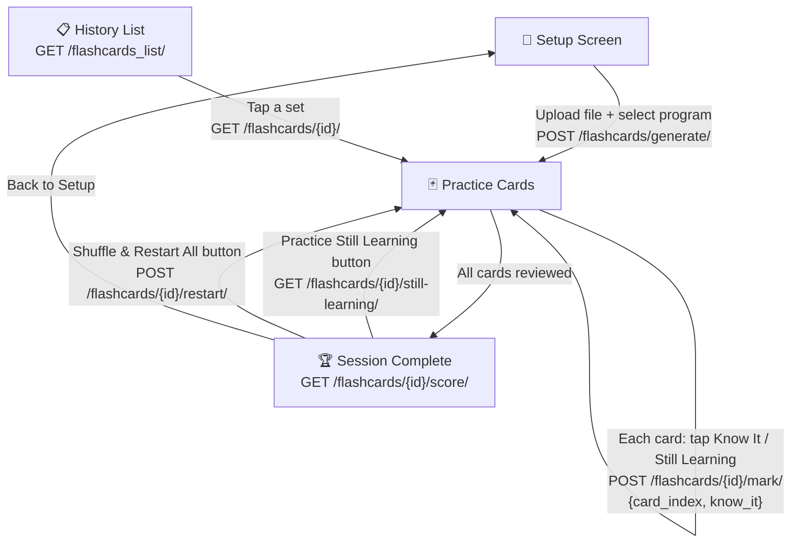

# 📚 Flashcard & NCLEX Quiz — Frontend API Documentation

> **Base URL:** `https://yourdomain.com/api/`
> **Auth:** All endpoints require `Authorization: Bearer <JWT_TOKEN>`
> **Content-Type:** `application/json` (unless uploading files → `multipart/form-data`)

---

## Table of Contents

| # | Endpoint | Method | URL |
|---|----------|--------|-----|
| 1 | [Generate Flashcards](#1-generate-flashcards) | `POST` | `/api/flashcards/generate/` |
| 2 | [History List](#2-history-list) | `GET` | `/api/flashcards_list/` |
| 3 | [Get Single Flashcard Set](#3-get-single-flashcard-set) | `GET` | `/api/flashcards/{id}/` |
| 4 | [Mark Card (Know It / Still Learning)](#4-mark-card) | `POST` | `/api/flashcards/{id}/mark/` |
| 5 | [Session Score](#5-session-score) | `GET` | `/api/flashcards/{id}/score/` |
| 6 | [Practice Still Learning](#6-practice-still-learning) | `GET` | `/api/flashcards/{id}/still-learning/` |
| 7 | [Shuffle & Restart All](#7-shuffle--restart-all) | `POST` | `/api/flashcards/{id}/restart/` |
| 8 | [Generate NCLEX Quiz](#8-generate-nclex-quiz) | `POST` | `/api/nclex/generate/` |
| 9 | [Get Single NCLEX Quiz](#9-get-single-nclex-quiz) | `GET` | `/api/nclex/{id}/` |
| 10 | [List NCLEX Quizzes](#10-list-nclex-quizzes) | `GET` | `/api/nclex/` |

---

## Flashcard Endpoints

---

### 1. Generate Flashcards

Creates flashcards from an uploaded file or pasted text content.

```
POST /api/flashcards/generate/
```

#### Headers

| Header | Value |
|--------|-------|
| `Authorization` | `Bearer <token>` |
| `Content-Type` | `multipart/form-data` |

#### Request Body (form-data)

| Field | Type | Required | Description |
|-------|------|----------|-------------|
| `file` | File | ❌ (one of `file` or `content_source` required) | Upload PDF, DOCX, PNG, JPG, JPEG |
| `content_source` | string | ❌ (one of `file` or `content_source` required) | Paste text content directly |
| `program` | string | ❌ | `"RN"` or `"LPN"` — exam type (default: `"RN"`) |
| `card_count` | integer | ❌ | Number of cards to generate (default: `10`) |

#### ✅ Success Response — `201 Created`

```json
{
  "id": 12,
  "program": "RN",
  "cards_requested": 10,
  "file_name": "pharmacology_notes.pdf",
  "total_cards": 10,
  "flashcards": [
    {
      "question": "What is the mechanism of action of Metformin?",
      "answer": "Decreases hepatic glucose production and increases insulin sensitivity in peripheral tissues.",
      "card_index": 0
    },
    {
      "question": "What are the signs of increased intracranial pressure (ICP)?",
      "answer": "Hypertension with widened pulse pressure, Bradycardia, Irregular respirations. Late and ominous sign — notify provider immediately.",
      "card_index": 1
    },
    {
      "question": "What lab values should be monitored for a patient on Digoxin?",
      "answer": "Digoxin level (therapeutic: 0.5-2.0 ng/mL), potassium, creatinine, heart rate.",
      "card_index": 2
    },
    {
      "question": "What is the antidote for Heparin overdose?",
      "answer": "Protamine sulfate.",
      "card_index": 3
    },
    {
      "question": "What are the early signs of Digoxin toxicity?",
      "answer": "Nausea, vomiting, anorexia, visual disturbances (yellow-green halos), bradycardia.",
      "card_index": 4
    },
    {
      "question": "When should a nurse hold Metoprolol?",
      "answer": "Hold if heart rate < 60 bpm or systolic BP < 100 mmHg. Notify provider.",
      "card_index": 5
    },
    {
      "question": "What is the antidote for Warfarin overdose?",
      "answer": "Vitamin K (phytonadione). For severe bleeding: Fresh Frozen Plasma (FFP).",
      "card_index": 6
    },
    {
      "question": "What patient education should be given for Warfarin?",
      "answer": "Avoid foods high in Vitamin K (leafy greens), report unusual bleeding or bruising, regular INR monitoring.",
      "card_index": 7
    },
    {
      "question": "What is the therapeutic INR range for Warfarin?",
      "answer": "2.0-3.0 for most indications; 2.5-3.5 for mechanical heart valves.",
      "card_index": 8
    },
    {
      "question": "What assessments should be done before administering Furosemide?",
      "answer": "Check potassium level, blood pressure, fluid status, weight, urine output, and hearing.",
      "card_index": 9
    }
  ],
  "created_at": "2026-08-13T14:30:00.123456Z"
}
```

#### ❌ Error Responses

**No file or content — `400`**
```json
{ "message": "Please upload a file or provide content_source." }
```

**Unsupported file — `400`**
```json
{ "message": "Unsupported file format." }
```

**No text extracted — `400`**
```json
{ "message": "No text found." }
```

**AI error — `500`**
```json
{ "message": "Invalid JSON returned by AI." }
```

---

### 2. History List

Returns all flashcard sets for the logged-in user. **Lightweight** — does not include the full flashcard data.

```
GET /api/flashcards_list/
```

#### Headers

| Header | Value |
|--------|-------|
| `Authorization` | `Bearer <token>` |

#### Request Body

None — this is a GET request.

#### ✅ Success Response — `200 OK`

```json
[
  {
    "id": 12,
    "program": "RN",
    "cards_requested": 10,
    "file_name": "pharmacology_notes.pdf",
    "total_cards": 10,
    "know_it_count": 9,
    "still_learning_count": 1,
    "mastered_percentage": 90.0,
    "created_at": "2026-08-13T14:30:00.123456Z"
  },
  {
    "id": 8,
    "program": "LPN",
    "cards_requested": 15,
    "file_name": "medsurg_chapter3.docx",
    "total_cards": 15,
    "know_it_count": 0,
    "still_learning_count": 0,
    "mastered_percentage": 0.0,
    "created_at": "2026-08-12T10:15:00.654321Z"
  },
  {
    "id": 3,
    "program": "RN",
    "cards_requested": 5,
    "file_name": "Manual Content",
    "total_cards": 5,
    "know_it_count": 5,
    "still_learning_count": 0,
    "mastered_percentage": 100.0,
    "created_at": "2026-08-10T09:00:00.000000Z"
  }
]
```

> **Frontend note:** Use `mastered_percentage` to show a progress badge on each history item. When user taps an item → call `GET /api/flashcards/{id}/` to load full cards.

---

### 3. Get Single Flashcard Set

Returns all flashcard data for a specific set — **same format as generate**, plus progress stats.

```
GET /api/flashcards/{id}/
```

#### Headers

| Header | Value |
|--------|-------|
| `Authorization` | `Bearer <token>` |

#### URL Parameters

| Param | Type | Description |
|-------|------|-------------|
| `id` | integer | Flashcard set ID (from history list or generate response) |

#### Request Body

None — this is a GET request.

#### ✅ Success Response — `200 OK`

```json
{
  "id": 12,
  "program": "RN",
  "cards_requested": 10,
  "file_name": "pharmacology_notes.pdf",
  "total_cards": 10,
  "know_it_count": 9,
  "still_learning_count": 1,
  "mastered_percentage": 90.0,
  "flashcards": [
    {
      "question": "What is the mechanism of action of Metformin?",
      "answer": "Decreases hepatic glucose production and increases insulin sensitivity in peripheral tissues.",
      "card_index": 0
    },
    {
      "question": "What are the signs of increased intracranial pressure (ICP)?",
      "answer": "Hypertension with widened pulse pressure, Bradycardia, Irregular respirations.",
      "card_index": 1
    },
    {
      "question": "What lab values should be monitored for a patient on Digoxin?",
      "answer": "Digoxin level (therapeutic: 0.5-2.0 ng/mL), potassium, creatinine, heart rate.",
      "card_index": 2
    }
  ],
  "created_at": "2026-08-13T14:30:00.123456Z"
}
```

#### ❌ Error Response — `404`

```json
{ "message": "Flashcard not found" }
```

---

### 4. Mark Card

User taps **"Know It"** or **"Still Learning"** during practice. Call this for **each card**.

```
POST /api/flashcards/{id}/mark/
```

#### Headers

| Header | Value |
|--------|-------|
| `Authorization` | `Bearer <token>` |
| `Content-Type` | `application/json` |

#### URL Parameters

| Param | Type | Description |
|-------|------|-------------|
| `id` | integer | Flashcard set ID |

#### Request Body

| Field | Type | Required | Description |
|-------|------|----------|-------------|
| `card_index` | integer | ✅ | 0-based index of the card (from `flashcards[].card_index`) |
| `know_it` | boolean | ✅ | `true` = Know It, `false` = Still Learning |

**Example — User taps "Know It" on card 0:**
```json
{
  "card_index": 0,
  "know_it": true
}
```

**Example — User taps "Still Learning" on card 3:**
```json
{
  "card_index": 3,
  "know_it": false
}
```

#### ✅ Success Response — `200 OK`

```json
{
  "card_index": 0,
  "know_it": true,
  "know_it_count": 9,
  "still_learning_count": 1,
  "total_cards": 10
}
```

> **Frontend note:** Use `know_it_count` and `still_learning_count` to update the live counter in the UI as the user swipes through cards.

#### ❌ Error Responses

**Missing fields — `400`**
```json
{ "message": "card_index and know_it are required." }
```

**Invalid index — `400`**
```json
{ "message": "card_index must be between 0 and 9." }
```

**Set not found — `404`**
```json
{ "message": "Flashcard set not found." }
```

---

### 5. Session Score

Called when all cards are done — shows the **"Session Complete!"** screen.

```
GET /api/flashcards/{id}/score/
```

#### Headers

| Header | Value |
|--------|-------|
| `Authorization` | `Bearer <token>` |

#### URL Parameters

| Param | Type | Description |
|-------|------|-------------|
| `id` | integer | Flashcard set ID |

#### Request Body

None — this is a GET request.

#### ✅ Success Response — `200 OK`

```json
{
  "id": 12,
  "program": "RN",
  "total_cards": 10,
  "know_it_count": 9,
  "still_learning_count": 1,
  "mastered_percentage": 90.0,
  "still_learning_indices": [3]
}
```

> **Frontend mapping to the Session Complete screen:**
>
> | Response Field | UI Element |
> |----------------|------------|
> | `mastered_percentage` | **90%** circle progress |
> | `know_it_count` / `total_cards` | **"9 of 10 cards mastered"** |
> | `know_it_count` | Green box — **"Know It: 9"** |
> | `still_learning_count` | Red box — **"Still Learning: 1"** |
> | `still_learning_count` | Button text — **"Practice Still Learning (1 cards)"** |

---

### 6. Practice Still Learning

User taps **"Practice Still Learning (X cards)"** button. Returns **only** the cards marked as "Still Learning".

```
GET /api/flashcards/{id}/still-learning/
```

#### Headers

| Header | Value |
|--------|-------|
| `Authorization` | `Bearer <token>` |

#### URL Parameters

| Param | Type | Description |
|-------|------|-------------|
| `id` | integer | Flashcard set ID |

#### Request Body

None — this is a GET request.

#### ✅ Success Response — `200 OK`

```json
{
  "id": 12,
  "program": "RN",
  "total_cards": 10,
  "still_learning_count": 1,
  "flashcards": [
    {
      "question": "What is the antidote for Heparin overdose?",
      "answer": "Protamine sulfate.",
      "card_index": 3
    }
  ]
}
```

> **Important:** Each card keeps its **original `card_index`**. When the user marks this card again during re-practice, send that same `card_index` to the `/mark/` endpoint.

---

### 7. Shuffle & Restart All

User taps **"Shuffle & Restart All"** button. Deletes all progress and returns all cards fresh.

```
POST /api/flashcards/{id}/restart/
```

#### Headers

| Header | Value |
|--------|-------|
| `Authorization` | `Bearer <token>` |
| `Content-Type` | `application/json` |

#### URL Parameters

| Param | Type | Description |
|-------|------|-------------|
| `id` | integer | Flashcard set ID |

#### Request Body

Empty `{}` or no body.

#### ✅ Success Response — `200 OK`

```json
{
  "id": 12,
  "program": "RN",
  "total_cards": 10,
  "progress_reset": 10,
  "flashcards": [
    {
      "question": "What is the mechanism of action of Metformin?",
      "answer": "Decreases hepatic glucose production and increases insulin sensitivity in peripheral tissues.",
      "card_index": 0
    },
    {
      "question": "What are the signs of increased intracranial pressure (ICP)?",
      "answer": "Hypertension with widened pulse pressure, Bradycardia, Irregular respirations.",
      "card_index": 1
    },
    {
      "question": "What lab values should be monitored for a patient on Digoxin?",
      "answer": "Digoxin level (therapeutic: 0.5-2.0 ng/mL), potassium, creatinine, heart rate.",
      "card_index": 2
    }
  ]
}
```

> `progress_reset` tells how many card records were cleared. The frontend should start a fresh practice session with these cards.

---

## NCLEX Quiz Endpoints

---

### 8. Generate NCLEX Quiz

Generates NCLEX-style multiple-choice questions from uploaded content.

```
POST /api/nclex/generate/
```

#### Headers

| Header | Value |
|--------|-------|
| `Authorization` | `Bearer <token>` |
| `Content-Type` | `multipart/form-data` |

#### Request Body (form-data)

| Field | Type | Required | Description |
|-------|------|----------|-------------|
| `file` | File | ❌ (one of `file` or `content_source` required) | Upload PDF, DOCX, PNG, JPG, JPEG |
| `content_source` | string | ❌ (one of `file` or `content_source` required) | Paste text content directly |
| `nclex_category` | string | ❌ | Category label (default: `"NCLEX Tips"`) |
| `question_requested` | integer | ❌ | Number of questions (default: `10`, max: `30`) |
| `question_type` | string | ❌ | `"Beginner"`, `"Intermediate"`, or `"Advanced"` (default: `"Beginner"`) |

#### ✅ Success Response — `200 OK`

```json
{
  "success": true,
  "id": 7,
  "category": "Pharmacology",
  "question_requested": 3,
  "content_file": "/media/notes/chapter5.pdf",
  "content_source": null,
  "quiz": [
    {
      "question": "A nurse is caring for a patient on Warfarin therapy. Which lab value should the nurse monitor?",
      "options": {
        "A": "BUN",
        "B": "INR",
        "C": "Hemoglobin A1C",
        "D": "Serum creatinine"
      },
      "answer": "B",
      "explanation": "INR (International Normalized Ratio) is used to monitor the therapeutic effect of Warfarin. The therapeutic range is 2.0-3.0."
    },
    {
      "question": "Which assessment finding should the nurse report immediately for a patient receiving IV Heparin?",
      "options": {
        "A": "Mild headache",
        "B": "Nausea after meals",
        "C": "Blood in the urine",
        "D": "Bruising at the IV site"
      },
      "answer": "C",
      "explanation": "Hematuria (blood in urine) indicates possible internal bleeding, a serious adverse effect of Heparin therapy requiring immediate intervention."
    },
    {
      "question": "A patient asks why they need to avoid leafy green vegetables while taking Warfarin. What is the nurse's best response?",
      "options": {
        "A": "They increase the risk of kidney stones.",
        "B": "They contain Vitamin K which counteracts Warfarin.",
        "C": "They cause dangerous drug interactions.",
        "D": "They raise blood pressure levels."
      },
      "answer": "B",
      "explanation": "Leafy greens are high in Vitamin K, which promotes clotting and directly counteracts Warfarin's anticoagulant effect."
    }
  ]
}
```

---

### 9. Get Single NCLEX Quiz

```
GET /api/nclex/{id}/
```

#### Headers

| Header | Value |
|--------|-------|
| `Authorization` | `Bearer <token>` |

#### URL Parameters

| Param | Type | Description |
|-------|------|-------------|
| `id` | integer | Quiz ID |

#### ✅ Success Response — `200 OK`

```json
{
  "data": [
    {
      "question": "A nurse is caring for a patient on Warfarin therapy. Which lab value should the nurse monitor?",
      "options": {
        "A": "BUN",
        "B": "INR",
        "C": "Hemoglobin A1C",
        "D": "Serum creatinine"
      },
      "answer": "B",
      "explanation": "INR is used to monitor Warfarin therapy. Therapeutic range: 2.0-3.0."
    }
  ]
}
```

---

### 10. List NCLEX Quizzes

```
GET /api/nclex/
```

#### Headers

| Header | Value |
|--------|-------|
| `Authorization` | `Bearer <token>` |

#### ✅ Success Response — `200 OK`

```json
{
  "data": [
    {
      "id": 7,
      "category": "Pharmacology",
      "question_requested": 10,
      "file": "notes/chapter5.pdf",
      "quiz": [ ... ],
      "created_at": "2026-08-13T14:30:00.123456Z"
    },
    {
      "id": 3,
      "category": "Med-Surg",
      "question_requested": 5,
      "file": null,
      "quiz": [ ... ],
      "created_at": "2026-08-12T09:00:00.000000Z"
    }
  ]
}
```

---

## 🔄 Complete User Flow



### Step-by-Step

| Step | User Action | API Call | What to Send | What You Get |
|------|------------|----------|--------------|--------------|
| **1** | Upload file, select RN/LPN, tap Generate | `POST /api/flashcards/generate/` | `file`, `program`, `card_count` | Full flashcard set with `id` and cards with `card_index` |
| **2** | Swipe through cards, tap "Know It" or "Still Learning" | `POST /api/flashcards/{id}/mark/` | `{ "card_index": 0, "know_it": true }` | Updated counts |
| **3** | Finish all cards → see score | `GET /api/flashcards/{id}/score/` | Nothing (GET) | `mastered_percentage`, `know_it_count`, `still_learning_count` |
| **4a** | Tap "Practice Still Learning" | `GET /api/flashcards/{id}/still-learning/` | Nothing (GET) | Only unmastered cards (with original `card_index`) |
| **4b** | Tap "Shuffle & Restart All" | `POST /api/flashcards/{id}/restart/` | Nothing / `{}` | All cards fresh, progress cleared |
| **5** | Open history | `GET /api/flashcards_list/` | Nothing (GET) | List of all sets with progress stats (no card data) |
| **6** | Tap a history item | `GET /api/flashcards/{id}/` | Nothing (GET) | Full flashcard data + progress stats |

---

## ⚠️ Important Notes for Frontend

1. **`card_index` is critical** — always use the `card_index` from the response when calling `/mark/`. Don't use your own counter — especially after "Practice Still Learning" where indices may not be sequential (e.g., `[3, 7]`).

2. **`program` values** — send exactly `"RN"` or `"LPN"`. Any other value defaults to `"RN"`.

3. **File upload** uses `multipart/form-data`, not `application/json`. When sending a file, include all other fields as form fields.

4. **History list is lightweight** — it does NOT include `flashcards[]` array. You must call `GET /flashcards/{id}/` to load the actual cards.

5. **Authentication** — all endpoints require JWT. If the token is expired or missing, you'll get:
   ```json
   { "detail": "Authentication credentials were not provided." }
   ```
   Status: `401 Unauthorized`
