# Next-Gen NCLEX Final Exam Module — Extended API Documentation & Integration Guide

This guide documents the complete lifecycle, business logic, endpoints, request formats, and response structures for the **5-Stage NCLEX Final Exam Simulator**.

---

## 📌 1. Architecture & Business Rules Overview

```mermaid
graph LR
    E1["Exam 1: Foundational<br/>(Diagnostic Assessment)"] -->|Finish Attempt| E2["Exam 2: Progressive<br/>(Targeted Review)"]
    E2 -->|Finish Attempt| E3["Exam 3: Progressive<br/>(Advanced Application)"]
    E3 -->|Finish Attempt| E4["Exam 4: Advanced<br/>(Comprehensive Assessment)"]
    E4 -->|Finish Attempt| E5["Exam 5: Expert<br/>(Pass Predictor Readiness)"]

    style E1 fill:#dcfce7,stroke:#16a34a,stroke-width:2px
    style E2 fill:#dbeafe,stroke:#2563eb,stroke-width:2px
    style E3 fill:#fef3c7,stroke:#d97706,stroke-width:1px
    style E4 fill:#f1f5f9,stroke:#94a3b8,stroke-width:1px
    style E5 fill:#f1f5f9,stroke:#94a3b8,stroke-width:1px
```



### Key Business Rules
1. **5 Sequential Simulated Exams**:
   - Exam 1: *Foundational* (Diagnostic Assessment · Tag: `Start Here`)
   - Exam 2: *Progressive* (Targeted Review)
   - Exam 3: *Progressive* (Advanced Application · Tag: `Up next`)
   - Exam 4: *Advanced* (Comprehensive Assessment)
   - Exam 5: *Expert* (Pass Prediction · Tag: `Pass Predictor`)
2. **85 Questions Delivered from a 200-Question Pool via Exam Blueprint**:
   - Each exam has a ~200-question pool.
   - When a student begins, the **Exam Blueprint Engine** balances 85 questions across Client Needs categories (*Management of Care*, *Safety and Infection Control*, *Health Promotion*, *Psychosocial Integrity*, *Basic Care & Comfort*, *Pharmacological Therapies*, *Reduction of Risk Potential*, *Physiological Adaptation*).
   - Case studies (6-question unfolding cases) remain grouped together in sequence.
   - The selected 85 question IDs are fixed to the attempt (`assigned_question_ids`) and **never regenerate** on reload or resume.
3. **Strict Single Attempt Rule (No Retakes)**:
   - Each exam can be completed **only once** per student account.
   - Once submitted, it is permanently `completed`; no new attempt can be created.
4. **Sequential Unlocking (Completion-Based, Not Score-Based)**:
   - Exam 1 is unlocked immediately for all students.
   - Exam $N$ unlocks as soon as Exam $N-1$ is `completed`, regardless of whether the score was 45% or 95%.
5. **Locked Display Messages**:
   - Locked cards display informative lock text: `"🔒 Complete Exam 2 to unlock"`.
6. **Server-Side Timer & Auto-Submit (150 Minutes)**:
   - A 150-minute server timer starts on exam initiation.
   - Re-opening or refreshing the browser retains server elapsed time (`remaining_seconds`).
   - If timer reaches zero, the exam is automatically submitted.
7. **Test Mode (No Answer Leaks During Exam)**:
   - While an exam is in progress, correct answers and rationale explanations are strictly hidden.
8. **Multi-Dimensional Post-Exam Analytics**:
   - **Readiness Level**: *Strong Readiness* ($\ge 78\%$), *Approaching Readiness* ($65\% - 77\%$), *Developing* ($< 65\%$).
   - **Client Needs Performance** breakdown.
   - **Clinical Judgment Measurement Model (CJMM)** breakdown (*Recognize Cues*, *Analyze Cues*, *Prioritize Hypotheses*, *Generate Solutions*, *Take Action*, *Evaluate Outcomes*).
   - **Body Systems / Specialties** breakdown.
   - **Strengths & Top 3 Areas to Improve** with direct study recommendations.
   - **Option-by-Option Explanations** for every question.

---

## 🔐 2. Authentication & Base URL

- **Base URL:** `/api/`
- **Headers:**
  ```http
  Authorization: Bearer <your_jwt_access_token>
  Content-Type: application/json
  ```
- **Response Wrapper:** All API responses are standard wrapped:
  ```json
  {
    "success": true,
    "message": "Request description",
    "status": 200,
    "data": { ... }
  }
  ```

---

## 📑 3. Summary of API Endpoints

| # | Action | Method | URL Path | Description |
|---|---|---|---|---|
| **1** | **List All 5 Exams** | `GET` | `/api/nclex/exams/` | Lists 5 exams with student progress, scores, lock messages, remaining timer, and UI action flags. |
| **2** | **Start / Resume Exam** | `POST` | `/api/nclex/exams/<exam_id>/start/` | Starts or resumes an exam attempt. Runs blueprint generator, assigns 85 questions, and returns active session data. |
| **3** | **Get Session Questions** | `GET` | `/api/nclex/exams/session/<session_id>/questions/` | Retrieves fixed 85 questions in order, answered list, flagged list, and server timer. |
| **4** | **Submit Question Answer** | `POST` | `/api/nclex/exams/answer/` | Records answer in Test Mode, tracks current index, and checks server timer. |
| **5** | **Toggle Question Flag** | `POST` | `/api/nclex/exams/session/<session_id>/flag/` | Flags or unflags a question for review. |
| **6** | **Pre-submission Summary** | `GET` | `/api/nclex/exams/session/<session_id>/summary/` | Overview before submission (e.g. 85 Total, 82 Answered, 3 Unanswered, 5 Flagged). |
| **7** | **Finish Exam & Analytics** | `POST` | `/api/nclex/exams/finish/<session_id>/` | Finalizes attempt, locks retakes, unlocks next exam, and returns comprehensive diagnostic analytics. |
| **8** | **Review Completed Exam** | `GET` | `/api/nclex/exams/review/<session_id>/` | Review score breakdown, readiness level, and option explanations at any time. |

---

## 🚀 4. Detailed Endpoint Specifications

---

### 1. List All 5 Exams (`GET /api/nclex/exams/`)

Retrieves the 5 sequential exams annotated with the student's status, scores, readiness tiers, and lock messages.

#### Response (200 OK)
```json
{
  "success": true,
  "message": "Request successful",
  "status": 200,
  "data": {
    "total_exams": 5,
    "completed_exams": 2,
    "exams": [
      {
        "id": 1,
        "order": 1,
        "title": "NCLEX Practice Exam 1",
        "subtitle": "Diagnostic Assessment",
        "tag": "Start Here",
        "level": "Foundational",
        "total_question": 85,
        "time_limit_mins": 150,
        "status": "completed",
        "is_unlocked": true,
        "lock_message": null,
        "score": 82.0,
        "readiness_level": "Strong Readiness",
        "completed_date": "Jan 6, 2025",
        "session_id": 101,
        "remaining_seconds": 0,
        "current_question_index": 84,
        "can_start": false,
        "can_resume": false,
        "can_review": true
      },
      {
        "id": 2,
        "order": 2,
        "title": "NCLEX Practice Exam 2",
        "subtitle": "Targeted Review",
        "tag": "",
        "level": "Progressive",
        "total_question": 85,
        "time_limit_mins": 150,
        "status": "completed",
        "is_unlocked": true,
        "lock_message": null,
        "score": 74.0,
        "readiness_level": "Approaching Readiness",
        "completed_date": "Jan 7, 2025",
        "session_id": 102,
        "remaining_seconds": 0,
        "current_question_index": 84,
        "can_start": false,
        "can_resume": false,
        "can_review": true
      },
      {
        "id": 3,
        "order": 3,
        "title": "NCLEX Practice Exam 3",
        "subtitle": "Advanced Application",
        "tag": "Up next",
        "level": "Progressive",
        "total_question": 85,
        "time_limit_mins": 150,
        "status": "available",
        "is_unlocked": true,
        "lock_message": null,
        "score": null,
        "readiness_level": null,
        "completed_date": null,
        "session_id": null,
        "remaining_seconds": 9000,
        "current_question_index": 0,
        "can_start": true,
        "can_resume": false,
        "can_review": false
      },
      {
        "id": 4,
        "order": 4,
        "title": "NCLEX Practice Exam 4",
        "subtitle": "Comprehensive",
        "tag": "",
        "level": "Advanced",
        "total_question": 85,
        "time_limit_mins": 150,
        "status": "locked",
        "is_unlocked": false,
        "lock_message": "🔒 Complete NCLEX Practice Exam 3 to unlock",
        "score": null,
        "readiness_level": null,
        "completed_date": null,
        "session_id": null,
        "remaining_seconds": 0,
        "current_question_index": 0,
        "can_start": false,
        "can_resume": false,
        "can_review": false
      },
      {
        "id": 5,
        "order": 5,
        "title": "NCLEX Practice Exam 5",
        "subtitle": "Pass Prediction",
        "tag": "Pass Predictor",
        "level": "Expert",
        "total_question": 85,
        "time_limit_mins": 150,
        "status": "locked",
        "is_unlocked": false,
        "lock_message": "🔒 Complete NCLEX Practice Exam 4 to unlock",
        "score": null,
        "readiness_level": null,
        "completed_date": null,
        "session_id": null,
        "remaining_seconds": 0,
        "current_question_index": 0,
        "can_start": false,
        "can_resume": false,
        "can_review": false
      }
    ]
  }
}
```

---

### 2. Start / Resume Exam (`POST /api/nclex/exams/<exam_id>/start/`)

Starts a new attempt (generating 85 questions via blueprint) or resumes an active attempt.

#### Response (201 Created / 200 OK)
```json
{
  "success": true,
  "message": "Exam started successfully.",
  "status": 201,
  "data": {
    "session_id": 103,
    "exam_id": 3,
    "title": "NCLEX Practice Exam 3",
    "subtitle": "Advanced Application",
    "level": "Progressive",
    "time_limit_mins": 150,
    "remaining_seconds": 9000,
    "current_question_index": 0,
    "flagged_question_ids": [],
    "total_questions": 85,
    "questions": [
      {
        "id": 271,
        "title": "Which intervention is the priority for a client at high risk for falls?",
        "topic": "Safety and Infection Control",
        "subtopic": "Accident / Error / Injury Prevention",
        "type": "radio",
        "level": "Foundational",
        "note": null,
        "passage": null,
        "unit": null,
        "options": [
          { "id": 325, "text": "Keep the bed in lowest position with call light in reach." },
          { "id": 326, "text": "Apply four side rails at all times." },
          { "id": 327, "text": "Encourage the client to walk without assistance." },
          { "id": 328, "text": "Place frequently used items on top shelf." }
        ]
      }
    ]
  }
}
```

---

### 3. Get Active Session Questions (`GET /api/nclex/exams/session/<session_id>/questions/`)

#### Response (200 OK)
```json
{
  "success": true,
  "message": "Request successful",
  "status": 200,
  "data": {
    "session_id": 103,
    "exam_id": 3,
    "title": "NCLEX Practice Exam 3",
    "subtitle": "Advanced Application",
    "level": "Progressive",
    "time_limit_mins": 150,
    "remaining_seconds": 8420,
    "is_expired": false,
    "current_question_index": 14,
    "total_questions": 85,
    "answered_question_ids": [271, 272, 273],
    "answered_count": 3,
    "flagged_question_ids": [272],
    "flagged_count": 1,
    "is_completed": false,
    "questions": [ ... ]
  }
}
```

---

### 4. Submit Answer (`POST /api/nclex/exams/answer/`)

Submits an answer in Test Mode.

#### Request Body
```json
{
  "session_id": 103,
  "question_id": 271,
  "answer": [325],
  "current_index": 1
}
```

#### Response (200 OK)
```json
{
  "success": true,
  "message": "Answer recorded successfully.",
  "status": 200,
  "data": {
    "message": "Answer recorded successfully.",
    "session_id": 103,
    "question_id": 271,
    "answered_count": 4,
    "total_questions": 85,
    "remaining_count": 81,
    "remaining_seconds": 8390,
    "is_all_answered": false
  }
}
```

---

### 5. Toggle Question Flag (`POST /api/nclex/exams/session/<session_id>/flag/`)

#### Request Body
```json
{
  "session_id": 103,
  "question_id": 271,
  "is_flagged": true
}
```

#### Response (200 OK)
```json
{
  "success": true,
  "message": "Question flag status updated.",
  "status": 200,
  "data": {
    "session_id": 103,
    "question_id": 271,
    "is_flagged": true,
    "flagged_question_ids": [271, 275],
    "flagged_count": 2
  }
}
```

---

### 6. Pre-Submission Summary (`GET /api/nclex/exams/session/<session_id>/summary/`)

Provides confirmation statistics before student clicks final submit.

#### Response (200 OK)
```json
{
  "success": true,
  "message": "Request successful",
  "status": 200,
  "data": {
    "session_id": 103,
    "exam_id": 3,
    "exam_title": "NCLEX Practice Exam 3",
    "total_questions": 85,
    "answered_count": 82,
    "unanswered_count": 3,
    "unanswered_question_ids": [288, 302, 310],
    "flagged_count": 5,
    "flagged_question_ids": [271, 275, 290, 305, 310],
    "remaining_seconds": 1240,
    "is_time_expired": false
  }
}
```

---

### 7. Finish Exam & Get Multi-Dimensional Analytics (`POST /api/nclex/exams/finish/<session_id>/`)

Finalizes the attempt, locks retakes, unlocks the next exam, and returns comprehensive analytics.

#### Response (200 OK)
```json
{
  "success": true,
  "message": "NCLEX Exam finished successfully.",
  "status": 200,
  "data": {
    "session_id": 103,
    "exam_id": 3,
    "exam_title": "NCLEX Practice Exam 3",
    "is_completed": true,
    "score": 81.2,
    "readiness_level": "Strong Readiness",
    "readiness_description": "High probability of passing the NCLEX on the first attempt under current performance standards.",
    "completed_at": "Jan 8, 2025",
    "next_exam_unlocked": true,
    "next_exam_id": 4,
    "next_exam_title": "NCLEX Practice Exam 4",
    "result": {
      "overall_score": 81.2,
      "readiness_level": "Strong Readiness",
      "readiness_tier": "high",
      "readiness_description": "High probability of passing the NCLEX on the first attempt under current performance standards.",
      "total_questions": 85,
      "total_correct": 69,
      "total_incorrect": 14,
      "total_skipped": 2,
      "passed": true,
      "client_needs_performance": [
        { "name": "Basic Care and Comfort", "total_questions": 7, "correct_answers": 7, "score_percentage": 100.0 },
        { "name": "Safety and Infection Control", "total_questions": 10, "correct_answers": 9, "score_percentage": 90.0 },
        { "name": "Management of Care", "total_questions": 17, "correct_answers": 14, "score_percentage": 82.4 },
        { "name": "Physiological Adaptation", "total_questions": 14, "correct_answers": 11, "score_percentage": 78.6 },
        { "name": "Pharmacological and Parenteral Therapies", "total_questions": 13, "correct_answers": 9, "score_percentage": 69.2 }
      ],
      "clinical_judgment_performance": [
        { "name": "Recognize Cues", "total_questions": 20, "correct_answers": 18, "score_percentage": 90.0 },
        { "name": "Evaluate Outcomes", "total_questions": 12, "correct_answers": 10, "score_percentage": 83.3 },
        { "name": "Generate Solutions", "total_questions": 15, "correct_answers": 12, "score_percentage": 80.0 },
        { "name": "Analyze Cues", "total_questions": 18, "correct_answers": 14, "score_percentage": 77.8 },
        { "name": "Take Action", "total_questions": 12, "correct_answers": 9, "score_percentage": 75.0 },
        { "name": "Prioritize Hypotheses", "total_questions": 8, "correct_answers": 5, "score_percentage": 62.5 }
      ],
      "body_system_performance": [
        { "name": "Cardiovascular", "total_questions": 18, "correct_answers": 16, "score_percentage": 88.9 },
        { "name": "Mental Health", "total_questions": 10, "correct_answers": 8, "score_percentage": 80.0 },
        { "name": "Respiratory", "total_questions": 15, "correct_answers": 11, "score_percentage": 73.3 }
      ],
      "strengths": [
        { "name": "Basic Care and Comfort", "score_percentage": 100.0, "total_questions": 7 },
        { "name": "Safety and Infection Control", "score_percentage": 90.0, "total_questions": 10 },
        { "name": "Recognize Cues", "score_percentage": 90.0, "total_questions": 20 }
      ],
      "areas_to_improve": [
        {
          "category": "Prioritize Hypotheses",
          "score_percentage": 62.5,
          "total_questions": 8,
          "recommendation": "Practice targeted questions and review study notes for Prioritize Hypotheses."
        },
        {
          "category": "Pharmacological and Parenteral Therapies",
          "score_percentage": 69.2,
          "total_questions": 13,
          "recommendation": "Practice targeted questions and review study notes for Pharmacological and Parenteral Therapies."
        }
      ],
      "review": [
        {
          "question_id": 271,
          "title": "Which intervention is the priority for a client at high risk for falls?",
          "type": "radio",
          "level": "Foundational",
          "client_needs": "Safety and Infection Control",
          "cjmm_function": "Take Action",
          "body_system": "Accident / Error / Injury Prevention",
          "user_answer": { "id": 325, "text": "Keep the bed in lowest position with call light in reach." },
          "correct_answer": { "id": 325, "text": "Keep the bed in lowest position with call light in reach." },
          "is_correct": true,
          "is_skipped": false,
          "is_flagged": false,
          "rationale_takeaway": "Keeping the bed in lowest position minimizes distance in case of accidental roll, and call light access enables patient assistance.",
          "option_explanations": [
            { "id": 325, "text": "Keep the bed in lowest position with call light in reach.", "is_correct": true, "rationale": "Correct: Direct priority environmental fall prevention." },
            { "id": 326, "text": "Apply four side rails at all times.", "is_correct": false, "rationale": "Incorrect: Four side rails constitute a physical restraint." }
          ],
          "explanation": "http://localhost:8080/media/explanations/q271_explanation.pdf"
        }
      ]
    }
  }
}
```

---

### 8. Review Completed Exam (`GET /api/nclex/exams/review/<session_id>/`)

Returns the stored multi-dimensional diagnostic analytics and complete question-by-question review for any completed attempt.

#### Response (200 OK)
Same schema as the `result` block in Endpoint #7.

---

## 📱 5. UI Integration Summary

```
1. Dashboard Load:
   GET /api/nclex/exams/
   -> Displays 5 Cards with:
      - Score badge & Readiness badge ("Strong Readiness") on completed exams.
      - "Resume Exam -> (Remaining: 1h 42m)" on in-progress exams.
      - "Start Exam ->" on current available exam.
      - Disabled button with "🔒 Complete Exam X to unlock" on locked exams.

2. Start / Resume:
   POST /api/nclex/exams/<id>/start/
   -> Saves `session_id`, begins 150m server countdown, loads 85 questions.

3. Question Interaction:
   - Student selects answer: POST /api/nclex/exams/answer/
   - Student flags question: POST /api/nclex/exams/session/<id>/flag/

4. Confirmation Modal before submission:
   GET /api/nclex/exams/session/<id>/summary/
   -> Shows: "85 Questions | 82 Answered | 3 Unanswered | 5 Flagged"

5. Submission:
   POST /api/nclex/exams/finish/<id>/
   -> Shows Score %, Readiness Tier, Client Needs chart, CJMM chart, Body Systems, Strengths/Weaknesses, and complete review.
```
